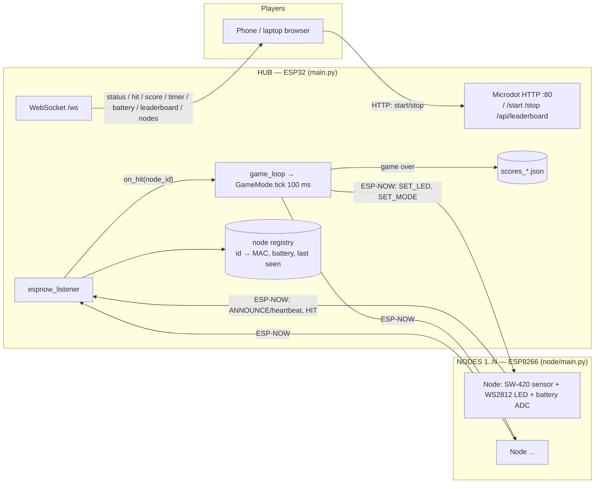
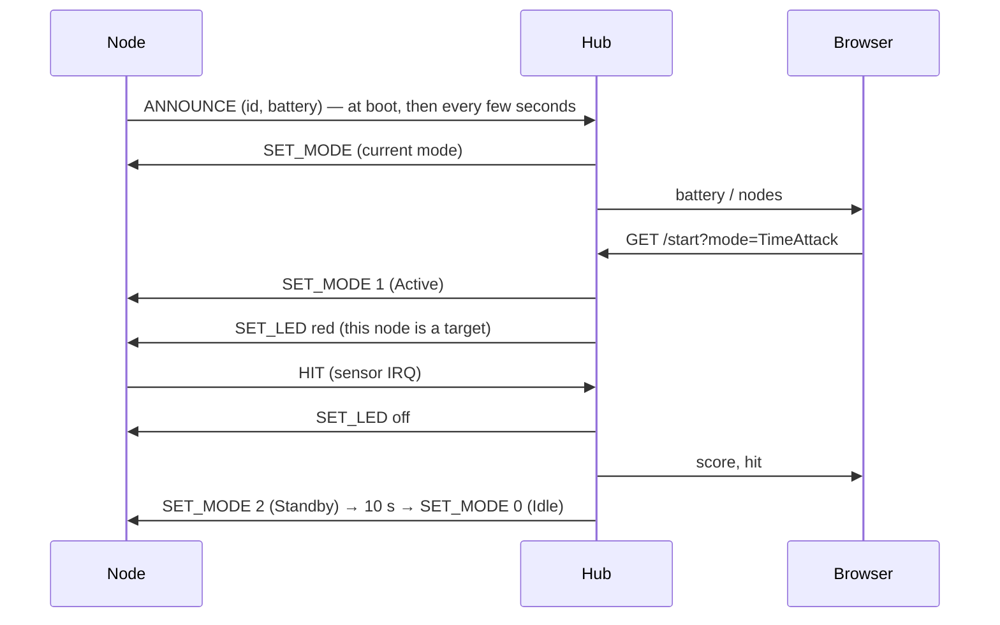

# Architecture

One **hub** (ESP32) runs the game and the web dashboard. N **nodes** (ESP8266 Wemos D1 Mini) are targets. They talk over ESP-NOW on WiFi channel 1. Phones and laptops join the hub's open AP `Airsoft-Master` and use the dashboard at http://192.168.4.1.

## Message flow

## Files

| Area | Repo file | Runs on |
|------|-----------|---------|
| Protocol (struct formats, constants) | `common/espnow_utils.py` | hub + node |
| Hub entry, radio, web server, scores | `hub/main.py` | hub (as `:main.py`) |
| Game modes | `hub/game_engine.py` | hub |
| Dashboard | `hub/static/index.html` | browser, served by hub |
| Web framework | `hub/lib/microdot*.py` | hub `:lib/` |
| Node firmware | `node/main.py` | each node (as `:main.py`) |

See CLAUDE.md "How the project works" for the packet layout and the mode values.
