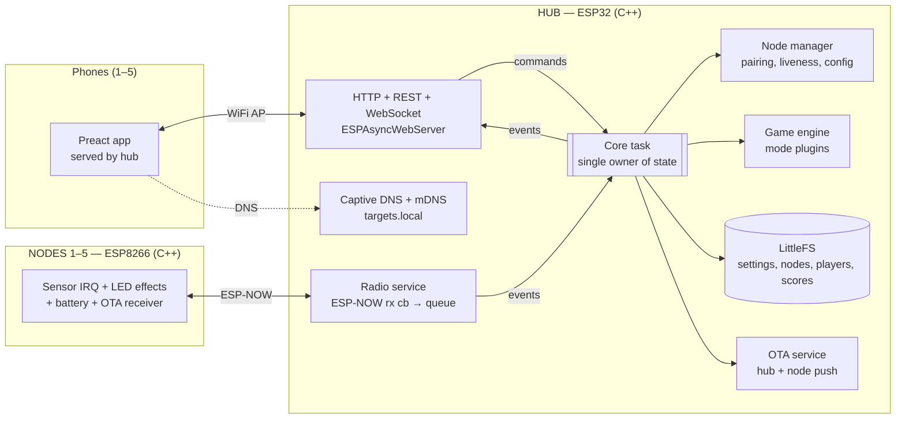
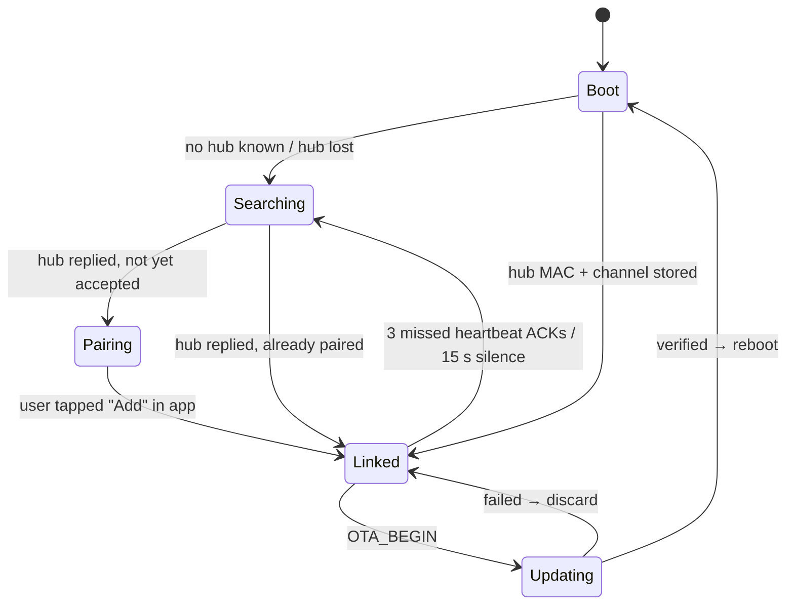

# ESP32 Targets — Version 2 plan

**Status:** APPROVED 2026-10-24 (stack B). Build branch: `v2/build`.
**Branch:** `v2/plan` → `v2/build` (from `master` = tag `v1.0`, which holds all v1 fixes).
**Date:** 2026-10-24

---

## 0. Summary

v1 works, but it has reached the limits of its platform. The hub's MicroPython heap is 56 KB, and playing both game modes with two phones connected already makes it grow into the memory WiFi needs (REVIEW #36). The firmware has only 10 sockets, nodes can only be updated over USB, setup still needs a PC, and the dashboard is a single desktop-style page.

v2 is a **rebuild on the same hardware** and needs **no new hardware**:

| Layer | v1 | v2 (proposed) |
|---|---|---|
| Hub firmware | MicroPython 1.27, `.mpy` | **C++17, Arduino-ESP32 3.x (ESP-IDF 5) via PlatformIO** |
| Node firmware | MicroPython 1.27 | **C++17, ESP8266 Arduino core 3.1 via PlatformIO** |
| Protocol | Python `struct`, duplicated per side | **One shared `protocol.h`** compiled into both |
| Web UI | 710-line hand-written HTML page | **Preact + TypeScript + Vite**, mobile-first, gzipped and **embedded in the hub firmware** |
| Storage | JSON files rewritten whole | LittleFS: atomic JSON for config, append-only JSONL for scores |
| Updates | `mpremote` over USB, one board at a time | **From the phone:** hub OTA by upload, node OTA pushed by the hub over ESP-NOW |
| Setup | Edit files on a PC | **Setup wizard + "Add target" flow** in the browser, plus a captive portal |
| Testing | Python sim of the hub | Host unit tests + N-node simulator + **virtual nodes on the real hub** |

The hard target is **1–5 nodes**. Everything is sized for 5 with headroom (the protocol and simulator are tested up to 8). The plan is designed so that **one physical node is enough to build and verify everything** (§11).

---

## 1. Goals and non-goals

### Goals
1. **Reliable with up to 5 targets.** No lost hits, a dead node detected within 2 s when it matters, and no memory starvation with 5 phones connected.
2. **Mobile-first GUI.** Phone in one hand, readable outdoors, thumb-reachable controls, no zooming.
3. **Easy setup.** Power on the hub, join WiFi, and the app opens and guides you through setup. Adding a target takes one tap, and no file editing or PC is ever needed after the first flash.
4. **Easy configuration.** Every tunable lives in a Settings screen: names, brightness, sensor sensitivity, battery calibration, WiFi name, password and channel.
5. **Maintainable.** Typed code, one protocol definition, automated tests, CI, and one-command build and deploy.
6. **Keep players' data.** v1 scores and node IDs are migrated. Backup and restore are available from the UI.

### Non-goals for v2
- Internet or cloud features, accounts, or a hub that joins a home router. ESP-NOW must share the router's channel, which adds complexity for little gain. This can come in v3.
- More than 8 nodes (the ESP-NOW peer limit is about 20, and encrypted peers are fewer still).
- Native iOS or Android apps. The browser is the app.
- New hardware. Optional add-ons are listed in §13, but nothing depends on them.

---

## 2. Hardware baseline (verified 2026-10-24)

| | Hub | Node (×1 now, up to 5) |
|---|---|---|
| Chip | ESP32-D0WD-V3 rev 3.1, dual core 240 MHz | ESP8266EX, 80/160 MHz |
| RAM | 520 KB SRAM, **no PSRAM** | ~80 KB user DRAM |
| Flash | 4 MB | 4 MB (Wemos D1 Mini) |
| MAC | `3c:8a:1f:7f:70:28` | `48:55:19:ed:f4:f4` |
| Peripherals used | WiFi AP + ESP-NOW only | SW-420 on GPIO5 (D1), WS2812 on GPIO0 (D3), battery on A0 |

**Constraints that drive the design:**
- **No PSRAM on the hub.** Every byte of heap is shared between WiFi, lwIP, ESP-NOW and the application, which rules out interpreted runtimes with a heap of their own.
- **The ESP8266 has a 250-byte ESP-NOW payload limit** and is not dual-core. Its firmware must stay small and non-blocking.
- **The node LED is on GPIO0**, a boot strapping pin (REVIEW #34). Firmware must keep working on GPIO0 for the existing node. New nodes can use GPIO4 (D2), so the LED pin is a per-node build/config value.
- **Phones on `http://192.168.4.1` are not a "secure context".** Service workers (offline PWA), the Screen Wake Lock API and installable PWAs are **unavailable**. The UI must load fast without them (§9.6).

---

## 3. Tech stack decision

### 3.1 Options considered

| | A. Stay on MicroPython | **B. C++ / Arduino on PlatformIO (recommended)** | C. Pure ESP-IDF (hub) |
|---|---|---|---|
| Hub free heap for app + WiFi | ~56 KB Python heap; growing it steals IDF heap (#36) | Typically 150 KB+ free after WiFi + web server (confirmed in spike S2) | Same as B, slightly more |
| Sockets / web clients | 10 sockets, 5 WS clients max | lwIP configurable; 5+ WS clients via ESPAsyncWebServer | Same |
| Hit latency / jitter | GC pauses of a few ms, 10 ms poll loop | Callback → queue, < 1 ms | Same |
| OTA (hub) | Possible but RAM-tight | Built in (dual app partitions + rollback) | Built in |
| OTA (node over ESP-NOW) | Hard: write `.py` chunks, no verify | `Update` class with MD5 verify | n/a (node is ESP8266) |
| Same stack on both boards | Yes | **Yes** (Arduino on both) | No: ESP8266 RTOS SDK is effectively unmaintained |
| Shared protocol code | Yes (Python) | Yes (`protocol.h`) | Partly |
| PC unit tests | Yes (stubbed) | Yes: PlatformIO `native` env, Unity | Yes, but heavier |
| Dev speed | Fastest to edit | Fast; big ecosystem | Slowest |
| Cost | Least work, but the ceiling stays | Rewrite of ~1 500 lines of logic (logic and tests port 1:1) | Most work |

### 3.2 Recommendation: **B**

- **Hub:** C++17, `espressif32` platform with the Arduino-ESP32 3.x framework (ESP-IDF 5 underneath, so IDF APIs are available when needed).
  - Libraries: `ESP32Async/ESPAsyncWebServer` + `ESP32Async/AsyncTCP` (the maintained forks, with WebSocket support), `bblanchon/ArduinoJson` 7, LittleFS (core), `DNSServer` + `ESPmDNS` (core), raw `esp_now.h`.
- **Node:** C++17, `espressif8266` platform with the Arduino core 3.1.
  - Libraries: `espnow.h` (core), `Adafruit NeoPixel` (handles the GPIO0 timing on ESP8266), LittleFS (config), `Updater` (core, for OTA).
- **Web UI:** Preact 10 + `@preact/signals` + TypeScript, built with Vite.
  - Plain CSS with design tokens (no Tailwind runtime, no UI kit) so the bundle stays at or under **60 KB gzipped**.
  - The build emits one gzipped HTML/JS/CSS bundle, which a script turns into a C header **embedded in the hub firmware**.
- **Tooling:** PlatformIO CLI (`pio`), Node 20 LTS for the UI, Python 3 for migration and log tools, GitHub Actions CI.

**Why the UI is embedded in the firmware and not stored on LittleFS:** `pio run -t uploadfs` reimages the whole filesystem, which would wipe the scores. With the UI inside the firmware, LittleFS holds **data only** and is never reimaged. One OTA file then updates firmware and UI together, so their versions can't drift apart.

**What this changes in project rules:** CLAUDE.md says "MicroPython, not Arduino/PlatformIO". If approved, CLAUDE.md is rewritten in milestone M9. The v1 MicroPython code is kept on a `v1` tag, with documented rollback steps (§12).

> **Decision 1 for you:** approve stack B, or choose A ("v1.5": keep MicroPython and do only the UI/UX and setup parts of this plan, accepting the memory ceiling).

---

## 4. System architecture



### 4.1 Hub concurrency model
- **One core task owns all state** (nodes, game, settings), in actor style. Every other component posts messages to its FreeRTOS queue: the ESP-NOW receive callback (WiFi task), web handlers (AsyncTCP task) and timers. **No locks, no shared mutable state.** This removes a whole class of race bugs.
- The core task runs a fixed **10 ms tick** for game timing on core 1. WiFi and lwIP stay on core 0.
- Outgoing WebSocket messages go into a small ring buffer. Slow clients are dropped (keeping the v1 #14 behaviour), and the oldest client is evicted when more than `MAX_WS_CLIENTS` (6) connect.
- The **task watchdog** is enabled, since the v1 `mpremote` conflict no longer exists. A boot loop counter in RTC memory enters **safe mode** after 3 crashes: game modes off, web UI on, so a bad update can be undone from the phone.
- A `GET /api/diag` endpoint and a status line on serial every 60 s report heap free, minimum heap ever, largest free block, WS clients and radio stats.

### 4.2 Code layout (hub)
```
firmware/hub/src/
  main.cpp              setup(): mount FS, load settings, start WiFi/radio/web/core
  core/                 CoreTask, message types, clock abstraction
  radio/                RadioService (esp_now wrapper, peer table, tx queue)
  nodes/                NodeManager, NodeRecord, pairing state machine
  game/                 GameEngine, IGameMode, modes/*.cpp
  store/                Settings, NodeStore, PlayerStore, ScoreStore (atomic write, JSONL)
  web/                  routes, ws hub, embedded asset table (generated)
  ota/                  HubOta, NodeOtaPusher
firmware/shared/        protocol.h, version.h, game constants
```
All game, node and protocol logic is **hardware-independent**: it takes an injected `Clock` and `RadioPort` interface. That is what makes the host tests and simulator in §11 possible.

---

## 5. Node firmware design

### 5.1 State machine


- **Searching:** scans channels 1–13, sending `HELLO` broadcasts (about 200 ms per channel). It finds the hub automatically, even after the hub's channel is changed in Settings. LED: slow white "breathe".
- **Pairing:** LED blinks amber until the user accepts it in the app. A hub setting, "Auto-accept new targets", is on by default during the setup wizard.
- **Linked:** unicast to the hub with MAC-layer ACK and up to 3 app-level retries (kept from v1). Heartbeat every 2 s, down from 5 s. That is cheap, and it lets the hub detect offline nodes in about 6 s instead of 15 s.

### 5.2 Node-side LED effects
v1 only accepted "set RGB". In v2 the hub sends **effects** and the node renders them locally:
`SOLID`, `OFF`, `BLINK(n, period)`, `PULSE(period)`, `FLASH(ms)` (hit feedback), and `RAMP(from→to, duration)` for the Zombie mode.

This lowers radio traffic, makes animations smooth and identical on every node, and lets the node **flash white instantly on a hit** without waiting for the hub. The PRD asked for that, and v1 couldn't do it.

### 5.3 Hit detection and timing
- The IRQ records `micros()`. A configurable **debounce** (default 300 ms) and a **glitch filter** (require N edges within W ms, default 1 edge) are tunable from the app per node, because SW-420 modules vary a lot.
- **Reaction time is measured on the node.** It is the time from the LED-on effect being applied to the IRQ, sent inside the HIT packet. This removes the radio delay from scores (REVIEW #30).
- Hits are queued (up to 8 in a ring buffer) and survive retries. The `seq` field lets the hub de-duplicate them (as in v1).

### 5.4 Node config (stored on the node in LittleFS, mirrored on the hub)
`node_id`, `name`, `hub_mac`, `channel`, `led_pin` (0 or 4), `brightness_max` (default 150 of 255, PRD limit), `debounce_ms`, `glitch_edges`, `glitch_window_ms`, `batt_scale` (from calibration), `system_id` (§6.3).

### 5.5 Battery
Readings are averaged, read at most every 2 s (v1 #9). The value is converted to % with a Li-ion curve lookup, not a linear one.
**Calibration flow in the app:** measure the battery with a multimeter, type in the reading, and the hub sends `batt_scale` to the node. Low-battery warnings are given at 20% and 10%. A pre-game check blocks the start (with an override) when a node is under 10%.

---

## 6. Radio protocol v3

### 6.1 Frame layout (little-endian, packed, ≤ 250 bytes)
```
struct Header {          // 8 bytes, in every frame
  uint8_t  magic;        // 0xA7
  uint8_t  version;      // 3
  uint16_t system_id;    // random per hub, set at pairing → two hub kits on one field don't mix
  uint8_t  type;         // message type
  uint8_t  node_id;      // 0 = unassigned
  uint16_t seq;          // per sender, for de-dup and ACK matching
};
```

| Dir | Type | Payload | Notes |
|---|---|---|---|
| N→H | `HELLO` | fw_version, hw_rev, caps bitmask, led_pin, battery_mv | broadcast while searching |
| N→H | `HEARTBEAT` | battery_mv, batt_pct, flags (charging, low), rssi_of_last_hub_frame | every 2 s |
| N→H | `HIT` | reaction_ms (0xFFFF = not lit), lit_effect_id, edges, uptime_ms | unicast + retry |
| N→H | `ACK` | acked_seq, status | for config/mode/OTA commands |
| N→H | `SENSOR_SAMPLE` | edge count, last_pulse_us | only in calibration mode |
| H→N | `WELCOME` | node_id, accepted flag, channel, system_id, hb_interval | answer to HELLO |
| H→N | `SET_MODE` | mode (Idle / Active / Standby / Calibrate) | needs ACK |
| H→N | `LED` | effect, r, g, b, param1, param2, effect_id | MAC ACK only, re-sent every 2 s while lit (v1 rule) |
| H→N | `CONFIG` | TLV list of config keys | needs ACK |
| H→N | `IDENTIFY` | seconds | node blinks white |
| H→N | `CHANNEL` | new_channel, switch_in_ms | before the hub changes channel |
| H→N | `OTA_BEGIN / OTA_DATA / OTA_END` | size + MD5 / offset + ≤ 200 bytes / commit | windowed ACKs |
| H→N | `REBOOT`, `FORGET` | — | |

- Commands that change state (`SET_MODE`, `CONFIG`, OTA) are **application-ACKed** with a 3× retry. A missing ACK marks the node as unreachable, as in v1.
- The hub only accepts frames from **paired MACs** with a matching `system_id`. That keeps out neighbours' kits and accidental spoofing. Optional ESP-NOW encryption (one LMK per node) is a **stretch goal**. Mixed ESP32↔ESP8266 encryption must be proven in spike S1 first, and the ESP32's limit on encrypted peers (7 by default) is enough for 5 nodes.
- v1 packets are **not** supported in v2. All nodes are reflashed once, and after that OTA keeps them on the same version. The hub refuses to activate a node whose protocol version doesn't match and offers "Update target" in the app instead.

### 6.2 Timing budget (target)
Hit IRQ → hub game logic: **< 15 ms p95** (radio ~4 ms + retry margin). Hub → LED on: **< 10 ms p95**. Measured in M2/M3 with the real node.

### 6.3 Capacity check for 5 nodes
Heartbeats are 5 × 0.5 Hz × ~30 B, which is negligible. The worst-case game burst is 5 LED commands + 5 hits within 100 ms, well within ESP-NOW capacity. The peer table uses 5 of about 20 slots.

---

## 7. Hub features

### 7.1 Node management
- Pairing (§5.1), with **slot numbers 1–5** that the user can reorder by drag in the app. The physical number on a target matches its slot.
- Per node: name, colour tag, number, battery, signal strength (RSSI), firmware version, last seen, hit count. Actions: identify, rename, renumber, calibrate sensor, calibrate battery, update firmware, reboot, forget.
- Online and offline tracking as in v1, plus an "unreachable" state from missing ACKs. Detection takes about 2 s when the node is lit and about 6 s otherwise.

### 7.2 Game engine
- An `IGameMode` interface: `describe()` (name, min/max nodes, **settings schema**), `start(cfg)`, `tick(now)`, `onHit(node, rt)`, `onNodeLost/Found`, `result()`.
- **The settings schema is sent to the UI**, which builds each mode's setup form automatically. Adding a mode needs no UI code beyond an optional custom HUD widget.
- Common start sequence (yellow ×3 → green), common pause/abort, and the common game-over → Standby → Idle flow (kept from v1).
- **Pre-game check:** online node count ≥ the mode minimum, battery, and protocol version.

### 7.3 Game modes
| Mode | Nodes | Status | Notes |
|---|---|---|---|
| Free Practice | 1–5 | **new**, simple | every hit flashes and shows reaction time; good for warm-up and sensor tuning |
| Time Attack+ | 1–5 | **port** from v1 | same scoring rules and difficulty table; tests ported |
| The Breach | 1–5 | **port** from v1 | fix #20 (flash green, then off) and #24 (save real hits and avg RT, skip 0-point games) |
| Shoot / No-Shoot | 2–5 | **new** (FEATURES #3) | red = shoot, green = hostage |
| Zombie Survival | 1–5 | **new** (PRD, FEATURES #5) | node-side `RAMP` effect; "bitten" at full brightness; waves |
| Drill | 1–5 | **new** (FEATURES #6) | user-defined target order + par time, saved courses |

Order of delivery: port first (Free Practice, Time Attack+, Breach), then the new modes in M8.

### 7.4 Players and scores
- **Players:** name + colour, created inline ("Who's shooting?" before Start). The last player is remembered per phone.
- **Scores:** append-only `scores/<mode>.jsonl`, one line per game: player, settings hash, score, hits, misses, avg RT, best combo, date, and a per-node hit/RT summary (for the stats in §9.4). The file is compacted to the top 50 per mode plus the last 200 games when it passes 64 KB.
- **The hub has no real-time clock.** The phone sends its time when it connects, and the hub keeps it from then on. A game played with no phone time set gets `date: null` (rare).
- Leaderboards are streamed from the file, never built in RAM (a v1 rule that still applies).

### 7.5 Settings (hub, `settings.json`)
System name, AP SSID, AP password (optional; the default is **open**, as in v1), WiFi channel (1/6/11 suggested), global LED brightness, auto-accept pairing, sounds on phone, default difficulty, units, max nodes (default 5). Changing the channel or SSID shows a warning and goes through a safe re-link flow (`CHANNEL` broadcast → switch → nodes re-search).

### 7.6 Storage layout (LittleFS, about 1.4 MB partition)
```
/settings.json      atomic write (tmp + rename), as in v1 #1
/nodes.json         MAC → slot, name, config mirror
/players.json
/scores/<mode>.jsonl
/courses.json       Drill courses
/ota/node.bin       staged node firmware (≤ ~450 KB)
/log/crash.txt      last crash reason + backtrace summary
```

### 7.7 Flash partitions (hub, 4 MB)
`nvs 20K | otadata 8K | app0 1.25M | app1 1.25M | littlefs ~1.4M | coredump 64K`. Hub OTA keeps a known-good image, and **automatic rollback** happens if the new image doesn't confirm itself healthy within 60 s.

---

## 8. Web API

All JSON, versioned under `/api/v1`. Small and flat.

| Method | Path | Purpose |
|---|---|---|
| GET | `/` | the app (gzipped, embedded, `Cache-Control` with an ETag = firmware build hash) |
| GET | `/api/v1/state` | snapshot: system, nodes, game, settings summary |
| GET/PUT | `/api/v1/settings` | read/update settings |
| GET | `/api/v1/nodes` | node list |
| PUT | `/api/v1/nodes/{mac}` | name, slot, colour, config |
| POST | `/api/v1/nodes/{mac}/{identify\|accept\|forget\|reboot\|calibrate}` | node actions |
| GET | `/api/v1/modes` | modes + settings schemas |
| POST | `/api/v1/game/start` · `/game/stop` | `{mode, settings, player}` |
| GET | `/api/v1/scores?mode=&player=&limit=` | streamed leaderboard |
| GET/POST/DELETE | `/api/v1/players` | |
| GET/PUT | `/api/v1/courses` | Drill courses |
| GET | `/api/v1/backup` | one JSON file: settings, nodes, players, scores |
| POST | `/api/v1/restore` | upload a backup (also used for the v1 migration) |
| POST | `/api/v1/ota/hub` | upload a hub `.bin` (MD5 checked) |
| POST | `/api/v1/ota/node` | upload a node `.bin`, then push it to the selected nodes |
| GET | `/api/v1/diag` | heap, uptime, radio stats, version |
| WS | `/ws` | server → client events: `state`, `node`, `game`, `hit`, `score`, `timer`, `result`, `ota`, `toast`. Client → server: `hello{time, clientId}`, `ping` |

Captive-portal probe URLs (`/generate_204`, `/hotspot-detect.html`, `/connecttest.txt` and others) are answered so phones **open the app automatically** when they join, and don't keep switching to mobile data (§9.6).

---

## 9. GUI design (mobile-first)

### 9.1 Principles
- **Phone first** (360–430 px wide). Tablets and laptops get a two-column layout from 768 px.
- **Outdoor-readable:** dark theme by default with high contrast (WCAG AA minimum, AAA for the HUD numbers) and a light "sunlight" theme toggle.
- **Big targets:** ≥ 48 px touch targets, with primary actions in the bottom third (thumb zone).
- **One task per screen,** with bottom sheets for options.
- **Feedback without looking:** phone vibration on hit/miss (Android), Web Audio beeps (start, hit, miss, game over), and a big colour flash on the HUD.
- **Works offline,** like the whole system: no CDN, fonts or icons from outside. Everything is bundled (system font stack + a ~3 KB inline SVG icon set).
- The style keeps a hint of the v1 tactical/CRT look (monospace numbers, accent green), cleaned up for readability.

### 9.2 Navigation
A bottom tab bar with 4 tabs: **Play · Targets · Scores · Settings**. A top status bar shows targets online (●●●○○), the lowest battery and the connection state. While a game runs, the tab bar is replaced by the full-screen HUD.

### 9.3 Screens (wireframes)

**First run — setup wizard** (shown until it's completed, and can be re-run from Settings)
```
┌──────────────────────────┐
│  Welcome to Targets      │
│  Step 1 of 4             │
│                          │
│  System name             │
│  [ Airsoft-Master     ]  │
│  WiFi password (optional)│
│  [                    ]  │
│                          │
│            [ Next  → ]   │
└──────────────────────────┘
 2. Add targets: "Switch on your targets…" (live list, auto-accept)
 3. Test: "Hit each target once" ✓ per node (sensor check)
 4. Done → Play
```

**Play**
```
┌──────────────────────────┐
│ ●●●○○ 3/5   🔋 62%   ⚡  │
├──────────────────────────┤
│ Who's shooting?          │
│ (Kris ▾)  [+ New]        │
│                          │
│ ┌──────────┐┌──────────┐ │
│ │ TIME     ││ BREACH   │ │
│ │ ATTACK+  ││          │ │
│ └──────────┘└──────────┘ │
│ ┌──────────┐┌──────────┐ │
│ │ SHOOT /  ││ ZOMBIE   │ │
│ │ NO-SHOOT ││  (2+ 🎯) │ │
│ └──────────┘└──────────┘ │
├──────────────────────────┤
│ Play  Targets Scores  ⚙  │
└──────────────────────────┘
```
Tapping a mode opens a **bottom sheet**: preset chips (Easy/Normal/Hard), the auto-generated settings, a "How to play" expander, the pre-game check result, and a big **START** button.

**Live game HUD** (full screen)
```
┌──────────────────────────┐
│ TIME ATTACK+     ■ STOP  │
│                          │
│         01:23            │
│        SCORE 340         │
│        COMBO x4          │
│                          │
│  [1]  [2]  [3]  [4]  [5] │  ← tiles mirror LED colours live
│  🔴   ⚫   🔴   ⚫   ░░   │     ░ = offline
│                          │
│ +10  #3  612 ms          │  ← hit feed
│ +10  #1  540 ms          │
│ −15  #2  (dark)          │
└──────────────────────────┘
```
- **STOP** needs a long press (prevents accidental aborts).
- The screen is kept awake with the "silent looping video" technique, because the Wake Lock API needs HTTPS.

**Result:** score, rank ("#3 all-time, best this week"), breakdown (hits, misses, avg RT, best combo), and per-target average RT bars. Buttons: Play again · Change settings · Scores.

**Targets**
```
┌──────────────────────────┐
│ Targets (3/5)  [+ Add]   │
├──────────────────────────┤
│ [1] Left door    ● online│
│     🔋 78%  📶 −52  v2.0 │
│     [Identify] [⋯]       │
├──────────────────────────┤
│ [2] Barrel       ● online│
│     🔋 12% ⚠    📶 −70   │
├──────────────────────────┤
│ [3] Window     ○ offline │
│     last seen 4 min ago  │
├──────────────────────────┤
│ New target found!        │
│ 48:55:19:…  [Blink] [Add]│
└──────────────────────────┘
```
The ⋯ menu offers rename, number, colour, **Sensor test** (live hit counter + debounce/glitch sliders, "hit it 5 times" guide), **Battery calibration**, Update firmware, Reboot, Forget.
**Tap-to-identify the other way round:** in Targets view, hitting a physical target highlights its card.

**Scores:** filter chips (mode, difficulty, period), the leaderboard, and a tap on a player opens their profile: best/avg score trend (small inline SVG sparkline), avg RT per target ("your slowest side"), games played.

**Settings:** sections for System (name, WiFi, channel), Targets defaults (brightness, sensitivity), Sound & haptics, Updates (hub version, upload `.bin`, node update status), Data (Backup ⬇, Restore ⬆, Migrate v1), Advanced (diagnostics, safe-mode reboot, factory reset with type-to-confirm).

### 9.4 State and data flow in the app
- One WebSocket. On connect, the server sends a full `state` snapshot, followed by events. A `signals` store holds the state.
- Automatic reconnect with backoff. A "Reconnecting…" banner is shown, and controls are disabled while disconnected.
- REST is used for mutations, with an optimistic UI update. A toast is shown on error with the server's reason (as in v1 #15).
- **Multiple phones:** all of them see the same live state, and any phone can control the game. The HUD shows "started by Kris's phone". Optional "spectator" phones work with no extra setup.

### 9.5 Accessibility and i18n
Colour is never the only signal (tiles also show a ✓/✕/number), and labels are on every control. Text lives in one `strings.ts`, English only for now, ready for Polish later.

### 9.6 Phone/OS realities (designed around them)
- **Android "no internet" switching.** The captive-portal probes are answered, so Android marks the network "connected, no internet" and offers "Stay connected". The wizard shows a one-time tip about this.
- **iOS captive mini-browser:** it closes when you leave it. The portal landing page has a big "Open Targets" button (`http://targets.local` → fallback `http://192.168.4.1`) to move to Safari.
- **No HTTPS**, so no service worker, no installable PWA and no Wake Lock. A web manifest + icon is still provided for "Add to Home screen" bookmarks. The bundle is ≤ 60 KB gzipped, so the first load takes well under 1 s on the AP.

---

## 10. Setup and day-to-day workflow (user view)

**First-time (once, with a PC):** flash the hub and each node over USB with `tools/deploy.sh` (PlatformIO). Optionally, M9 adds a **browser flasher** page (ESP Web Tools on GitHub Pages) so new nodes can be flashed from Chrome with no toolchain.

**Every session:**
1. Switch on the hub, then the targets. Targets find the hub by themselves (§5.1).
2. Join the WiFi `Airsoft-Master` from the phone. The app opens automatically.
3. Pick a player and a mode, then Start.

**Adding a 4th or 5th target:** flash it once, switch it on, and tap **Add** in the app. That's all.

**Updating everything:** download the release `.bin` files to the phone, then Settings → Updates → upload. The hub updates itself, then pushes the update to each target one after another.

---

## 11. Testing strategy (with only one physical node)

| Level | What | Where | Covers |
|---|---|---|---|
| Unit | protocol encode/decode, every game mode, node manager, score store, settings validation | PlatformIO `native` env (Unity), on PC and CI | logic, edge cases, 1–8 nodes |
| Simulation | Port of `tools/fake_nodes.py`: the real hub core with N virtual nodes, a virtual clock, packet loss, node deaths and reboots | `native` env, CI | the v1 pass criteria (unique IDs, offline detection, max no-target gap ≤ 2.5 s) for 1, 2, 3, 4, 5, 8 nodes |
| **Virtual nodes on the real hub** | Debug build flag `VIRTUAL_NODES=n`: the hub adds n simulated nodes inside its radio service (shown with a **SIM** badge), alongside the real node | real hub + phone | the **full UI and game flow with 5 targets**, using one real one; heap and timing under 5-node load |
| Hardware | latency p95, hit delivery (≥ 99.5% of 1 000 simulated hits), pairing, channel change, re-link after hub reboot, OTA, battery calibration, 2 h soak | real hub + real node | real radio, real sensor |
| UI | component tests (Vitest), mock hub (a small Node WebSocket server replaying recorded sessions) for UI development without hardware, Playwright smoke tests at iPhone SE / Pixel 7 viewports | PC, CI | layouts, flows, reconnect |
| Load | 5 browser WS clients + page reloads during a 5-node virtual game; `diag` heap watch | real hub | **acceptance: free heap ≥ 80 KB min, no client starvation** |
| Field | checklist run outdoors with a phone (sunlight, distance 30 m, real BBs) | you | the real thing |

**Recommended but optional:** 1–2 extra Wemos D1 Minis (about €3 each) so real multi-node radio contention can be tested. The plan does not depend on them.

---

## 12. Migration from v1 and rollback

1. **Before anything is flashed:** a full backup of both boards with `mpremote` into `backup_hub/` and `backup_node/` (dated), plus a copy of the current MicroPython firmware `.bin` for each chip.
2. `tools/migrate_v1.py` converts `scores_TimeAttack.json`, `scores_TheBreach.json` and `nodes.json` into one v2 backup file. `scores_time_attack.json` (old format) is converted too if you want it (**Decision 5**).
3. Flash v2 (**needs your explicit approval at that moment**, per the CLAUDE.md rules). Settings → Data → Restore, using the migration file. The existing node keeps slot 1.
4. **Rollback:** reflash MicroPython 1.27 and copy the backup files back. This is documented step by step in `docs/v2/ROLLBACK.md` and tried once on the node during spike S1.
5. v1 code: tag `v1.0` on the commit where `review/full-pass` is merged to `master`. v2 lives under `firmware/` and `web/`, and v1 folders (`hub/`, `node/`, `common/`) are moved to `legacy/` in M9.

---

## 13. Optional hardware add-ons (not required, can be added later)
| Add-on | Value | Cost |
|---|---|---|
| Piezo buzzer per node (GPIO4/D2 or D5) | sound at the target | < €1 per node |
| Hub status LED + button | "start last game" without a phone; shows hub alive | < €1 |
| Extra D1 Minis | real multi-node testing | ~€3 each |
| LED on GPIO4 for new nodes | avoids the GPIO0 boot-strap risk (#34) | free (wiring) |

The firmware gets `caps` bits for these from day one, so adding them later needs no protocol change.

---

## 14. Repository layout (v2)
```
firmware/
  shared/             protocol.h, version.h (shared by hub + node + native tests)
  hub/                platformio.ini (envs: hub, hub_debug_virtual, native), src/, test/
  node/               platformio.ini (envs: node_gpio0, node_gpio4), src/, test/
web/                  Vite + Preact + TS app; `npm run build` → firmware/hub/src/web/assets.gen.h
tools/
  deploy.sh           build + flash + verify (never touches data partitions)
  migrate_v1.py
  serial_log.py       (kept)
  mock_hub/           WS mock server for UI development
docs/v2/              this plan, PROTOCOL.md, USER_MANUAL.md, SETUP_GUIDE.md, ROLLBACK.md
legacy/               v1 MicroPython (moved in M9)
.github/workflows/ci.yml   native tests + both firmware builds + web build/test
```

---

## 15. Milestones

Each milestone ends with a demo, a commit series on a `v2/*` branch, and your go-ahead before the next one. Size: **S** ≈ one session, **M** ≈ 2–3, **L** ≈ 4+.

| # | Milestone | Size | Exit criteria |
|---|---|:-:|---|
| **M0** | **Spikes** (throw-away code). **S1:** Arduino hub ↔ Arduino ESP8266 node ESP-NOW with the AP active on ch 1: unicast ACK, latency, encryption interop, then restore MicroPython on the node (rollback test). **S2:** ESPAsyncWebServer + WS with 5 clients on the hub, measure heap. **S3:** ESP-NOW OTA throughput to the node. | M | numbers recorded in `docs/v2/SPIKES.md`; go / no-go on stack B; **needs approval to reflash** |
| M1 | Foundation: repo skeleton, `protocol.h` + tests, PlatformIO envs, web scaffold, mock hub, CI green | S | `pio test -e native` + `npm test` pass in CI |
| M2 | Node firmware: state machine, channel search, pairing, effects, hit timing, config, battery | M | real node pairs, gets effects, hits delivered ≥ 99.5%, p95 < 15 ms |
| M3 | Hub core: core task, radio, node manager, storage, settings, watchdog, safe mode, diag | M | 5 virtual + 1 real node tracked; offline detection times met; reboot-safe storage |
| M4 | Web API + WS + captive portal + mDNS + embedded asset pipeline; UI shell (tabs, status bar, Targets screen) | M | phone joins AP → app opens; targets list live; identify works |
| M5 | Game engine + Free Practice, Time Attack+, Breach (ported tests pass) + simulator in CI | M | simulator passes for 1–5 and 8 nodes; real game on the real node |
| M6 | Full GUI: setup wizard, Play flow, HUD, results, Scores, players, Settings, sensor test, battery calibration, sounds and haptics | L | Playwright smoke passes; you play a full session from your phone |
| M7 | OTA: hub upload + rollback; node push over ESP-NOW with MD5; UI progress | M | hub and node updated from the phone; deliberately corrupted image rejected |
| M8 | New modes: Shoot/No-Shoot, Zombie, Drill + courses; player stats | M | each mode has unit + sim tests and a real-node playtest |
| M9 | Migration of real v1 data, load + soak + field test, docs (manual, setup, rollback), CLAUDE.md rewrite, legacy move, tag `v2.0` | M | all acceptance criteria in §16 met |

**Critical path:** M0 → M1 → M2/M3 (in parallel where possible) → M4 → M5 → M6. M7 and M8 can be swapped if you'd rather have new modes before OTA.

---

## 16. v2 acceptance criteria
1. 5 targets (1 real + 4 virtual, plus real ones if available) through a full session of every mode, with no stalls, crashes or lost hits.
2. Hub free heap ≥ 80 KB at all times with 5 phones connected during a game; no watchdog resets in a 2 h soak.
3. Hit delivery ≥ 99.5%; hit → hub p95 < 15 ms; hub → LED p95 < 10 ms (real node).
4. A dead node is detected in ≤ 3 s when lit and ≤ 8 s otherwise; the game continues with the remaining nodes.
5. From a factory-fresh hub: join WiFi → app opens → wizard → first game in **under 3 minutes** without a PC.
6. Adding a pre-flashed target takes **one tap**.
7. Hub and node firmware updated from a phone; failed or corrupt updates never brick a board.
8. All v1 scores visible in v2 after migration; backup → factory reset → restore round-trips with no loss.
9. Every screen is usable at 360 px width with one hand; Lighthouse accessibility ≥ 90 on the mock-hub build.

---

## 17. Risks
| Risk | Likelihood | Impact | Mitigation |
|---|:-:|:-:|---|
| ESP32 Arduino ↔ ESP8266 ESP-NOW quirks (channel with AP, encryption interop) | M | H | spike S1 before committing; encryption is optional |
| Node OTA over ESP-NOW unreliable or slow | M | M | spike S3; MD5 verify before commit; USB flashing always remains as fallback |
| ESP8266 has no automatic OTA rollback | L | H | verify MD5 before `Update.end(true)`; keep the node app small and well tested; staged rollout one node at a time |
| Phones drop the AP (no internet) | H | M | captive probes answered, wizard tip, reconnect banner |
| Embedded UI grows the firmware past the 1.25 MB app partition | L | M | 60 KB bundle budget enforced in CI |
| Rewrite takes longer than planned | M | M | milestones are usable increments; v1 stays on `master` and keeps working until M9 |
| Only one physical node hides multi-node radio bugs | M | M | simulator + virtual nodes + suggested extra D1 Minis |
| Data loss during migration | L | H | double backup, dry-run migration on a copy, restore verified before v1 data is touched |

---

## 18. Decisions (answered 2026-10-24)
| # | Question | Decision |
|---|---|---|
| 1 | Stack | **B: C++/Arduino + Preact** (approved) |
| 2 | Reflash | **Approved.** The boards were unplugged on 2026-10-24, so code is prepared now and flashed in the next session (backup first, node first). |
| 3 | Merge + tag | **Done:** `review/full-pass` fast-forwarded into `master`, tagged `v1.0`, branch deleted. v1 code moved to `legacy/v1/` on `v2/build`. |
| 4 | WiFi | **Open by default; optional password in Settings** (WPA2, 8–63 chars, empty = open). |
| 5 | `scores_time_attack.json` | **Dropped:** not migrated (it is still in the local backup folders). |
| 6 | New mode order | **Shoot/No-Shoot → Drill → Zombie.** Shoot/No-Shoot reuses the Time Attack+ scheduler and is the cheapest multi-node mode; Drill needs a course editor; Zombie needs the node `RAMP` effect to be proven on hardware first. |
| 7 | Extra hardware | Open. The plan doesn't depend on it. |
| 8 | OTA vs new modes | **Hub OTA (upload) in M6, node OTA over ESP-NOW in M7, then the new modes in M8.** Hub OTA is cheap (built in). Node OTA matters before nodes 2–5 are built, so they are never flashed by USB twice. |

## 19. Build environment note (2026-10-24)
The build VM's root disk was 98% full (1.7 GB free), and the ESP32 Arduino 3.x toolchain needs about 2 GB. The node toolchain, the web tooling and host tests fit; the **hub firmware compile needs more disk** (grow the VM disk, or free space) before flashing.
